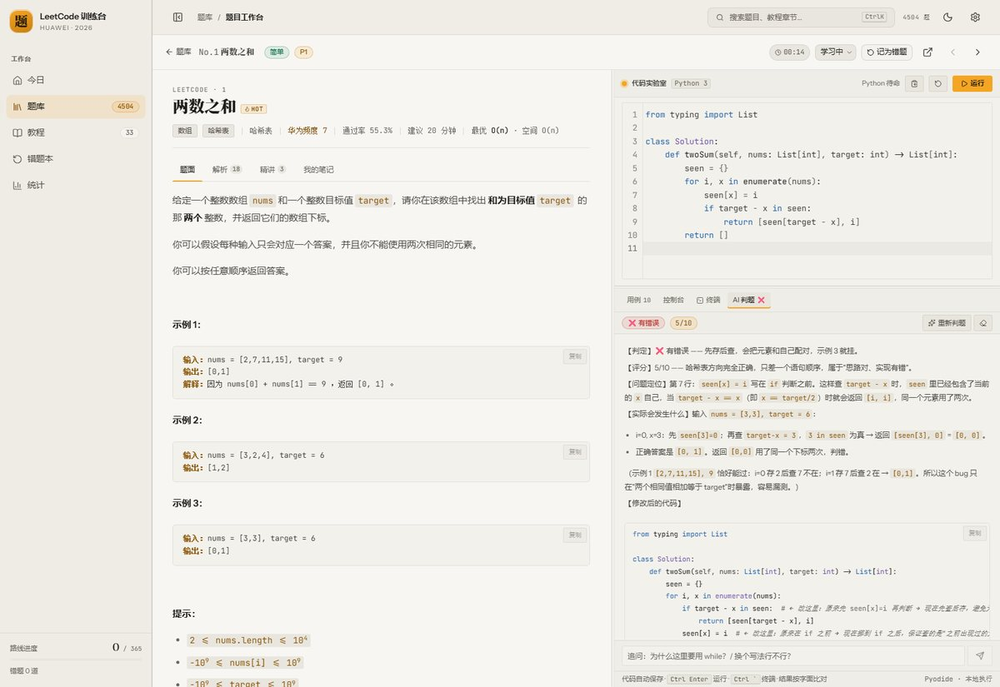

# LeetCode 训练台

一个跑在自己电脑上的刷题工具。**AI 读题给你讲、AI 看你的代码判对错、AI 按你的写法改代码**，4504 道题全都在本地，不用注册、不用联网（除了调 AI）。


## AI 到底帮你做三件事

**① 判题：不是「跑过了」就完事**

点「AI 判题」，它会把题面、官方示例、你本地跑用例的结果、以及你的代码一起读一遍，然后给出：

- **判定**：✅ 通过 / ❌ 有错误 / ⚠️ 无法确定
- **评分**：0–10 的整体逻辑分（10 = 可以直接交，5 = 方向对但实现有错）
- **错在哪**：具体到第几行，并且**拿一个具体输入走一遍**，写清这段代码实际输出什么
- **改好的代码**：如果你的写法有可取之处，它**保留你的方法名、变量名、整体结构**，只改有问题的地方，每一处改动都在行尾标 `# ← 改这里：原来是什么 → 为什么`，照着看就能定位
- **结论**：最后一行只给「通过 / 不通过」，和判定不一致时按更保守的那个算



**② 讲解：3708 道题都有**

- 365 道精选题：4000–5000 字的深度精讲（思路怎么来的、为什么不会漏、边界反例、面试追问、同类题）
- 其余 3400 多道：1000 字左右的短解析（一句话思路 / 怎么做 / 复杂度 / 易错点 / 追问）
- 覆盖 3708 / 4504 = 82.3%，剩下 796 道是没有题面的会员题

**③ 边界用例：示例不够用**

官方示例太温和。每道题按参数类型生成了 4–8 条边界用例（空数组、单元素、极值、重复元素），22739 条里 12163 条带期望输出。写对了是绿的，漏了边界会红给你看。参考解只保证过官方示例，所以「和参考解不一致」只标黄、不判错。

## 还有

| | |
| --- | --- |
| 题库 | 4504 道，Hot 100 / 面试经典 150 / 365 道精选题标记；筛选状态同步到 URL；`j`/`k` 翻题 |
| 代码台 | 内置 Python（Pyodide），`Ctrl+Enter` 运行，不用装环境 |
| 学习闭环 | 今日计划、错题本（间隔复习）、热力图、提交记录 |
| 界面 | 深色 / 浅色 / 跟随系统；F11 真全屏；全键盘可操作 |

## 装起来

到 [Releases](https://github.com/ranranxuejie/leetcode-desk/releases/latest) 下载 `LeetCode-Desk-Setup-*.exe`，双击安装。装到当前用户目录，不用管理员权限，卸载保留进度。

**AI 功能要一个 Key**（自己申请，几块钱能用很久）：设置 → AI 解析 → 粘进去 → 保存并验证。Key 只存在本机 `%LOCALAPPDATA%\LeetCode训练台\deepseek.key`，前端拿不到完整内容。

申请地址：https://platform.deepseek.com/api_keys

> 克隆源码跑的话：`launcher\fetch-webview2.ps1` 拉依赖 → `build.ps1` 编译；`data/` 里的题面缓存和参考解不入库，用 `tools/fetch_full_bank.py` 重新抓。

## 改代码

```bash
cd app
npm run unit     # 34 条纯函数断言
npm run verify   # 19 项页面回归（自己拉无头 Chrome）
npm run check    # tsc + oxlint + 上面两个
```

改之前先跑 `npm run check`。这个项目没有 CI，这脚本就是唯一防线。

## 短板

- AI 参考解只保证过官方示例，边界没验证；边界期望跟它同源，约 3.6% 不一致，这类只标黄。
- 790 道会员题没有题面，四叉树（427/558）和 NestedInteger（385）本地跑不了。
- AI 判题会误判。分数和结论是给你参考的，不是判决书 —— 有疑问就看它给的「实际会发生什么」，自己跑一遍。
- 题库版权归 LeetCode，仅供个人学习。

细节：[已知限制](docs/已知限制.md) · [设计规范](docs/设计规范.md) · [动效规范](docs/动效规范.md) · [改进循环](docs/改进循环.md)

## License

MIT（代码部分；题库内容见 LICENSE 末尾说明）
