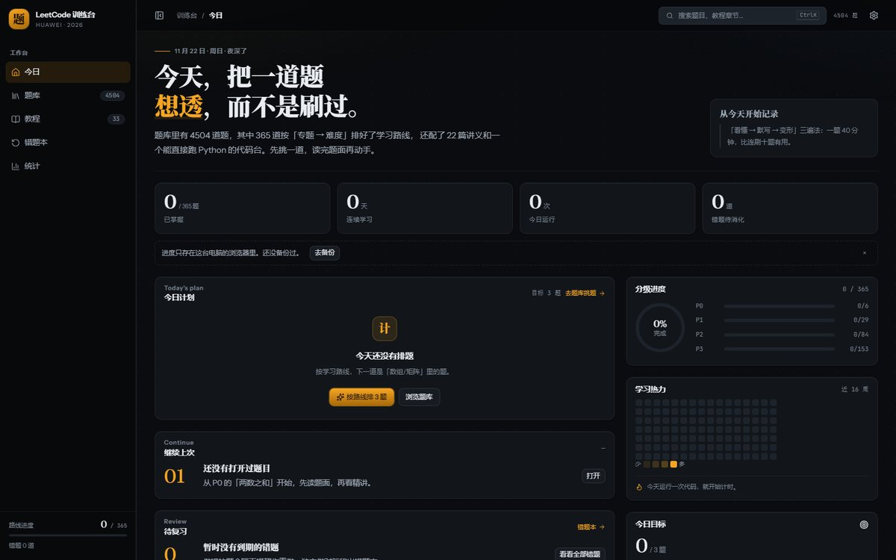
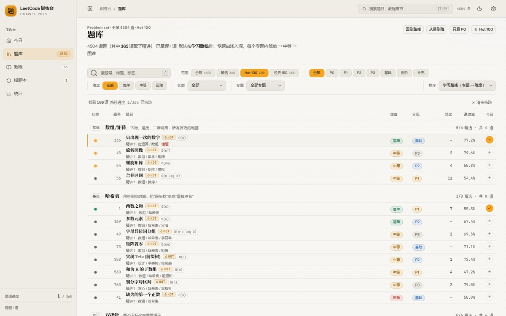
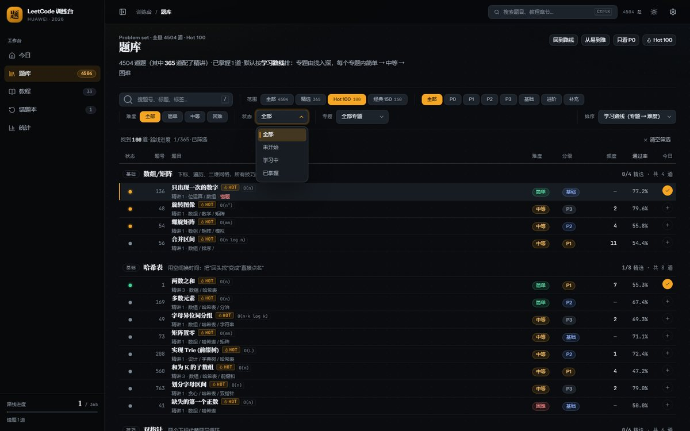

# LeetCode 训练台

一个装在自己电脑上的刷题工具。4504 道题，代码在浏览器里直接跑，Hot 100 配了 AI 精讲。



## 为什么不用力扣网页刷

三个原因：

**不用切窗口**。题面、代码、用例、终端在一屏里，写两行就能按 `Ctrl+Enter` 跑，不用等页面刷新，也不用担心断网。

**用例不止示例那三条**。官方示例太温和，很多"能过样例"的代码边界一碰就碎。这里每道题补了 4–8 条边界用例（空数组、单元素、极值），22739 条里 12163 条有期望输出。写对了就是绿的，漏了边界会红给你看。

**卡住的时候有东西看**。Hot 100 每题一篇四千多字的精讲，3112 道题带参考解，都能一键载进编辑器跑通再对着改。

## 跑起来

**装成桌面应用**：`launcher\LeetCode训练台-安装程序.exe`，双击，装到当前用户目录，不用管理员权限。装完桌面有图标，卸载在「设置 → 应用」里。

**或者浏览器里跑**：

```bash
cd app
npm install
npm run dev        # http://127.0.0.1:5173
```

> 克隆下来还不能直接跑，缺三样东西（都太大，没进仓库）：
> - `launcher\fetch-webview2.ps1` 拉 WebView2 SDK，再 `build.ps1` 编译桌面版
> - `python tools/fetch_full_bank.py` 抓题库缓存（`data/`，24MB）
> - `python tools/build_web_data.py` 汇编前端数据（`app/public/data`）

## 配 AI 解析

设置 → AI 解析，粘一个 DeepSeek Key 进去，点「保存并验证」。会真的发一次请求确认能用。

Key 存在 `%LOCALAPPDATA%\LeetCode训练台\deepseek.key`，只在本机，前端拿不到完整内容。没有 Key 也能刷题，只是 AI 现场解析和 AI 判题用不了。

申请地址：https://platform.deepseek.com/api_keys

## 界面

深色 / 浅色 / 跟随系统，设置里切，顶栏也有个按钮。侧栏能收成图标条，题面和代码区的分栏能拖，按 `?` 看全部快捷键。

<table>
<tr><td></td>
<td></td></tr>
</table>

## 数据从哪来

题目和题面来自力扣公开接口（`data/statements_full.json`，24MB 缓存）。精讲、参考解、边界期望是 AI 生成后跑通官方示例才留下的。整条管线在 `tools/`：

```bash
python tools/fetch_full_bank.py      # 抓题面
python tools/gen_edge_cases.py       # 生成边界输入
python tools/gen_ref_solutions.py    # AI 写参考解并算出期望输出
python tools/build_web_data.py       # 汇编给前端
python tools/audit_data.py           # 自检
```

## 改代码

```bash
cd app
npm run unit     # 34 条纯函数断言
npm run verify   # 19 项页面回归（自己拉无头 Chrome）
npm run check    # tsc + oxlint + 上面两个
```

改之前先跑 `npm run check`。这个项目没有 CI，这脚本就是唯一防线。

## 已知的短板

- AI 参考解只保证过官方示例，边界情况没验证；边界期望跟它同源，实测约 3.6% 不一致，所以这类不一致只标黄、不判错。
- 790 道会员题没有题面。四叉树（427/558）和 NestedInteger（385）本地跑不了。
- 题库版权归 LeetCode，仅供个人学习。

细节在 [已知限制](docs/已知限制.md)，设计在 [设计规范](docs/设计规范.md) 和 [动效规范](docs/动效规范.md)，迭代过程在 [改进循环](docs/改进循环.md)。

## License

MIT（代码部分；题库内容见 LICENSE 末尾说明）
